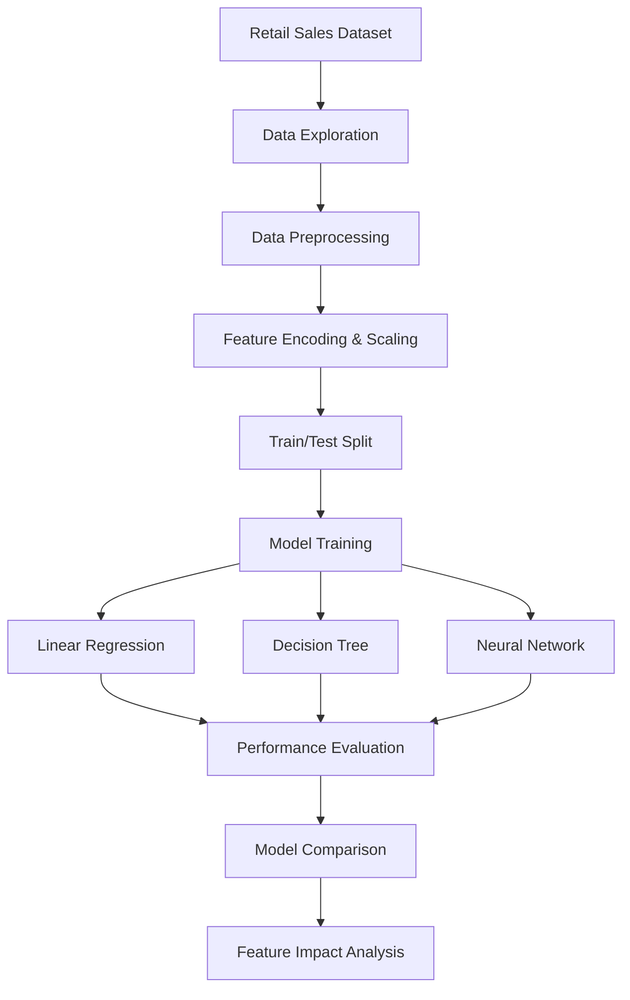

<div align="center">

<picture>
  <source
    media="(prefers-color-scheme: dark)"
    srcset="https://readme-typing-svg.demolab.com?font=Fira+Code&weight=700&size=27&duration=3000&pause=1000&color=36BCF7&center=true&vCenter=true&width=850&lines=EDA+Selling+Price+Prediction;Exploratory+Data+Analysis;Machine+Learning+%7C+Regression+Models"
  />
  <source
    media="(prefers-color-scheme: light)"
    srcset="https://readme-typing-svg.demolab.com?font=Fira+Code&weight=700&size=27&duration=3000&pause=1000&color=1764A0&center=true&vCenter=true&width=850&lines=EDA+Selling+Price+Prediction;Exploratory+Data+Analysis;Machine+Learning+%7C+Regression+Models"
  />
  
</picture>

### 📊 Retail Selling Price Prediction Using Machine Learning

*Exploring retail sales data through analytics and predictive modelling*

<br/>


<br/>


</div>

---

## 📖 Project Overview

Accurate selling price prediction can support
retail businesses in understanding product
pricing patterns and making informed decisions.

**EDA Selling Price Prediction** is a machine
learning project developed to investigate
relationships between retail sales attributes
and product selling prices.

The project combines:

- Exploratory Data Analysis (EDA)
- Data preprocessing
- Correlation analysis
- Feature encoding and scaling
- Regression-based machine learning
- Neural network modelling
- Performance evaluation
- Feature impact investigation

The primary objective is to predict
**`selling_price_per_unit`** using information
from retail sales transactions.

> [!IMPORTANT]
> The original experiments produced extremely
> high predictive scores. These results require
> careful interpretation because of potential
> feature leakage and the strong relationship
> between cost price and selling price.

---

## 🎯 Project Objectives

- Explore retail sales data and pricing patterns.
- Identify relationships between dataset features.
- Handle categorical and numerical attributes.
- Visualize feature distributions and correlations.
- Implement multiple regression algorithms.
- Compare prediction performance.
- Investigate the influence of cost price.
- Identify limitations affecting model reliability.

---

## 🗂️ Dataset Information

**Dataset:** Sales from Different Stores

**Source:** Kaggle

[View Original Dataset](https://www.kaggle.com/datasets/kzmontage/sales-from-different-stores)

| Property | Description |
|:---|:---|
| Dataset | Sales from Different Stores |
| Total Records | 99,457 |
| Dataset Columns | 13 |
| Prediction Target | Selling Price per Unit |
| Problem Type | Supervised Regression |
| Original Split | 70% Training / 30% Testing |

### Dataset Attributes

<details>
<summary><b>📋 Click to expand: Dataset Features</b></summary>

<br/>

The dataset contains the following fields:

| Feature | Description |
|:---|:---|
| Invoice Number | Transaction identifier |
| Invoice Date | Transaction date |
| Customer ID | Customer identifier |
| Gender | Customer gender |
| Age | Customer age |
| Category | Product category |
| Quantity | Purchased quantity |
| Selling Price per Unit | Prediction target |
| Cost Price per Unit | Product unit cost |
| Payment Method | Transaction payment method |
| Region | Sales region |
| State | Geographic state |
| Shopping Mall | Retail location |

</details>

---

## 🔄 Machine Learning Workflow

The project follows an exploratory and
predictive modelling workflow.



> [!NOTE]
> This diagram summarizes the original
> experimental workflow. The preprocessing
> and data-splitting sequence is documented
> as originally implemented.

---

## 🔍 Exploratory Data Analysis

EDA was performed to understand the dataset
and investigate relationships between
sales attributes.

### Key Analysis Components

- Dataset inspection
- Feature distribution analysis
- Categorical attribute exploration
- Correlation analysis
- Data visualization
- Identification of pricing relationships

### Important Correlation Findings

| Feature Relationship | Reported Correlation |
|:---|---:|
| Cost Price vs. Selling Price | 1.00 |
| State vs. Region | 0.46 |
| Cost Price vs. Quantity | 0.37 |
| Selling Price vs. Quantity | 0.34 |

### Interpretation

The strongest reported relationship is
between **`cost_price_per_unit`** and
**`selling_price_per_unit`**.

This suggests that cost price is highly
informative for predicting selling price
within the dataset.

However, such a strong relationship also
raises questions about target dependency
and real-world generalization.

---

## 🧠 Machine Learning Models

Three primary models were trained and
compared in the original experiments.

### 1. Linear Regression

A regression baseline used to investigate
linear relationships between input features
and selling price.

### 2. Decision Tree Regressor

A tree-based model capable of learning
nonlinear relationships between features
and target values.

### 3. Neural Network — MLPRegressor

A multilayer perceptron model used to
explore neural network-based regression.

<details>
<summary><b>⚙️ Click to expand: Additional Model Information</b></summary>

<br/>

The notebook also includes an SVM-based
regression section.

However, the SVM execution was skipped
because of computational cost.

Therefore, SVM results are not included
in the reported model comparison.

</details>

---

## 📊 Experimental Results

The following results were reported in
the original CSE422 academic project.

### Model Performance Comparison

| Model | MSE | R² Score |
|:---|---:|---:|
| Linear Regression | 3246.8542 | 0.996351 |
| Decision Tree | 0.0554 | 1.000000 |
| Neural Network | 4.0417 | 0.999995 |

**MSE:** Mean Squared Error

**R²:** Coefficient of Determination

### Observations

- Linear Regression produced a high reported R².
- Decision Tree achieved the lowest reported MSE.
- Neural Network also produced a very high R².
- The near-perfect scores require further
  investigation before making claims about
  real-world predictive performance.

> [!CAUTION]
> These values are reported results from
> the original academic experiments.
> They have not been independently reproduced
> using a leakage-resistant evaluation pipeline.

---

## 🧪 Feature Impact Experiment

The project also investigated how model
performance changed when the feature
**`cost_price_per_unit`** was removed.

### Results Without Cost Price

| Model | MSE | R² Score |
|:---|---:|---:|
| Decision Tree | 0.0847 | 0.9999999 |
| Neural Network | 88546.1234 | 0.900488 |

### Key Findings

The Neural Network experienced a substantial
performance decrease when cost price
was excluded.

This suggests that the original model
depended heavily on this feature.

The Decision Tree continued to report
extremely high predictive performance.

These observations motivate further
investigation of feature dependencies,
target-related information, data leakage,
and model generalization.

---

## ⚠️ Limitations & Evaluation Considerations

<details>
<summary><b>🔬 Click to expand: Technical Limitations</b></summary>

<br/>

### 1. Preprocessing Leakage

The original notebook applies feature
scaling before splitting the dataset.

This can allow information from the
test distribution to influence preprocessing.

A more robust evaluation would fit
preprocessing transformations only
on training data.

### 2. Target-Related Features

The reported correlation between cost
price and selling price is 1.00.

Further investigation is necessary
to determine whether the dataset
contains deterministic or target-derived
pricing relationships.

### 3. Categorical Encoding

Label encoding can introduce artificial
numerical ordering for categorical variables.

Different encoding strategies may be
more appropriate depending on the
model and feature characteristics.

### 4. Generalization

Near-perfect performance on a single
train/test split does not guarantee
reliable performance on unseen retail data.

Independent validation and feature
ablation experiments would provide
stronger evidence of generalization.

</details>

---

## 🛠️ Technology Stack

<div align="center">

| Category | Technologies |
|:---|:---|
| Programming | Python |
| Data Analysis | Pandas, NumPy |
| Machine Learning | Scikit-learn |
| Visualization | Matplotlib |
| Neural Network | MLPRegressor |
| Development | Jupyter Notebook |

</div>

---

## 📂 Repository Structure

The repository contains the original Jupyter Notebook,
academic project report, and project documentation.

```text
EDA-Selling-Price-Prediction/
│
├── CSE422_Project_Final_Code.ipynb
├── CSE422 Group 04 Project Report.pdf
│
└── README.md
```

### 📁 File Descriptions

| File | Description |
|:---|:---|
| `CSE422_Project_Final_Code.ipynb` | Main Jupyter Notebook containing exploratory data analysis, preprocessing, machine learning models, and evaluation |
| `CSE422 Group 04 Project Report.pdf` | Original academic report covering methodology, experiments, results, and conclusions |
| `README.md` | Project overview, dataset information, methodology, results, and documentation |

> [!NOTE]
> The original academic notebook and project
> report are preserved to maintain the
> authenticity of the Group 04 coursework.

---

## 📚 Academic Background

This project was developed as part of
**CSE422: Artificial Intelligence**
at **BRAC University**.

**Section:** 09

**Group:** 04

The original academic project includes
exploratory data analysis, machine learning
experiments, and performance comparisons.

---

## 👥 Project Contributors

<div align="center">

### 🎓 BRAC University — Group 04

</div>

| Student ID | Group Member |
|:---:|:---|
| 21201498 | Faiza Binte Arif |
| 21201171 | Naeem Islam |
| 21141058 | Mohammad Omar Raihan |
| 21241049 | Shafin Islam Ohin |

**Institution:** BRAC University

**Course:** CSE422 — Artificial Intelligence

**Project Type:** Academic Group Project

---

## 📖 References & Resources

- [Sales from Different Stores Dataset](https://www.kaggle.com/datasets/kzmontage/sales-from-different-stores)
- [Scikit-learn Documentation](https://scikit-learn.org/stable/)
- [Pandas Documentation](https://pandas.pydata.org/docs/)
- [NumPy Documentation](https://numpy.org/doc/)
- [Jupyter Documentation](https://docs.jupyter.org/)

---

<div align="center">

### 📈 Turning Retail Data into Predictive Insights

*Exploring data, understanding patterns,
and building responsible machine learning solutions.*

**Developed by Group 04 | BRAC University**

<br/>


</div>
